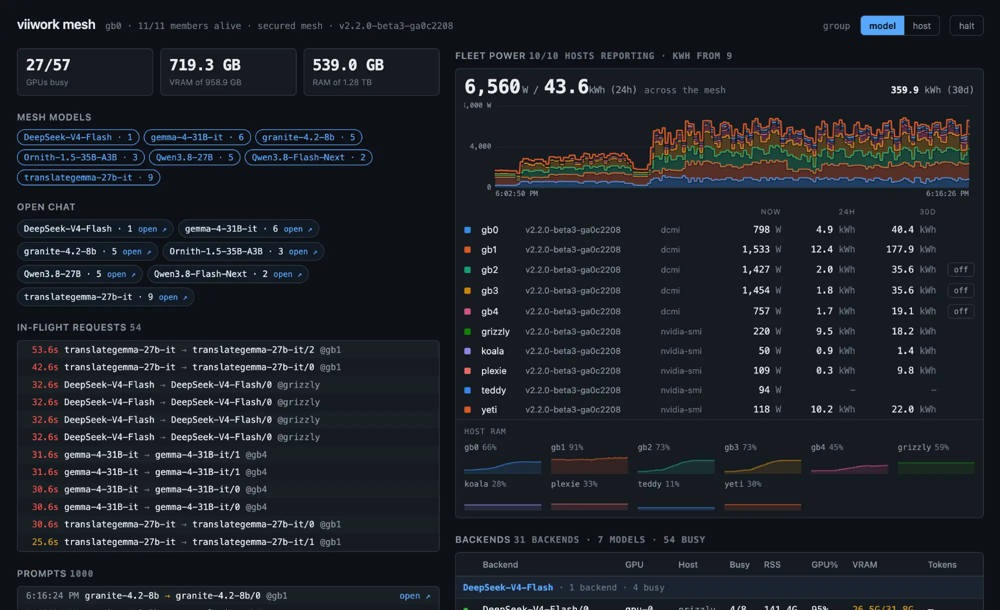

# Dashboards

Every page is served on port 8086 by every node, and needs no configuration.

| Page | What it is |
|---|---|
| [`/`](#node-dashboard) | This node: its models, backends, GPUs and activity |
| [`/mesh`](#mesh-dashboard) | The whole cluster, served identically by every node |
| [`/chat`](#chat) | A lightweight chat UI |
| [`/prompt`](#prompt-and-output-history) | One request's prompt and output, full page |



- [Node dashboard](#node-dashboard)
- [Chat](#chat)
- [Mesh dashboard](#mesh-dashboard)
- [Prompt and output history](#prompt-and-output-history)

## Node dashboard

`http://<machine>:8086/`, for that node:

- One table per model — engine, busy slots and queue — with a row per backend:
  GPUs, status and phase, busy slots, RSS, GPU utilisation, VRAM, decode progress
  and respawns
- A fleet line: members alive, mesh models, fleet power and cost
- Live in-flight request timers and the activity log (newest first)
- Host memory graph, live GPU utilisation and VRAM graphs (1 hour history, SSE
  updates), power consumption and electricity cost

## Chat

`/chat` is a lightweight chat UI for quick model interaction. It is addressable
— `/chat?model=<id>` preselects a model and `&host=<node>` pins it to one machine
— and `/mesh` links into it with one **Open Chat** entry per model. Aliases are
listed after the real models.

The **backend** selector lists every machine currently serving the chosen model.
`mesh` (the default) routes as always, and each reply names the node that ran it
and the node that forwarded it there.

## Mesh dashboard

**`http://<any-machine>:8086/mesh`** — the same view from every node, so any
machine you can reach shows you the whole mesh.

- **Mesh Models** — every model across the cluster; click one to filter the view
- **Aliases** — every alias with its target and backends; hover a row for its
  state, fallbacks and what it resolves to now; `shadowed` and `unavailable` are
  highlighted
- **In-Flight Requests** — live jobs with elapsed time, task tag, model, and the
  backend and host serving them
- **Prompts** — the most recent requests across the mesh, newest first. Every row
  links to a full-page view of that request's prompt and output; see
  [Prompt and output history](#prompt-and-output-history)
- **Fleet totals** — GPUs busy, VRAM and host RAM across the whole mesh, as three
  plain readings at the top of the page
- **Fleet Power** — live wattage and the last 24 hours' energy for the whole mesh
  (`1,751 W / 12.4 kWh (24h)`), with the 30-day total at the far right, then all
  three per host. The kWh half needs the energy store enabled; see
  [power-and-energy.md](power-and-energy.md)
- **Host RAM** — a strip of small per-host sparklines under the power panel, each
  scaled 0 to that host's total so the height reads as memory pressure. Hover a
  frame for the absolute figures. Figures are coarsened to 1/64 of the host's
  total (about 1 GB on a 64 GB host) — they
  are coarsened before being pushed so a value that moves every second cannot
  flood the live stream. `/v1/cluster` carries the exact numbers.
- **Backends** — backend id, GPUs, host, busy slots, RSS, GPU%, VRAM and decode
  progress for every machine, grouped by model or by host. Grouped by host, each
  host header also carries that host's wattage. Members that are not alive stay
  listed, greyed, with their state.

Hosts are listed by name throughout — the power rows, the stacked bands and the
RAM strip all read node-a, node-b, node-c… rather than reordering themselves as
load shifts, and a host keeps its colour from first sight.

### How it stays live

The page opens a single stream and never polls. Your browser only ever talks to
the node you opened; **that node reaches the other members itself**, so they do
not need to be reachable from wherever you are viewing.

Other members' *jobs* appear in real time. Their *backend counts and GPU load*
refresh every 5 seconds, from each member's `/v1/status`.

In-flight requests are reconstructed by your browser from the event stream,
because no endpoint returns "what is running now". The stream replays the last 30
seconds when it connects, plus every request still running however old, so
opening the page mid-flight shows the jobs already running, and a laptop coming back from sleep gets the completions it missed
instead of leaving rows counting up in red forever. A gap longer than the node's
event ring is not recoverable: the view then shows fewer requests than are really
running rather than phantom ones, and the Backends table's in-flight counts stay
correct either way.

**Halt** (the button in the header, or press `h`) freezes the whole view so rows
stop moving while you read or click them. Events that arrive during a halt are
queued (the newest 1000) and applied in order when you resume — the button shows
how many are waiting.

## Prompt and output history

Each node keeps the prompt **and the response** of its **last 1000 requests in
memory**, evicted oldest-first. Nothing is written to disk and nothing survives a
restart — this is a debugging aid, not an audit log. Prompt and output are each
truncated at 50 000 characters.

The `/prompt` page's header shows the request's wall time and, when the node
saw a token count, the reply's size and average rate: `296 tokens · 57.5 tok/s`.
The rate is generation alone, from the first token to the end. For a plain
(non-streamed) reply, or a request another node executed, the node saw no
first token; the rate is then over the whole request, prompt reading included,
and says so.

The depth is configurable:

```yaml
activity:
  prompt_history: 1000   # default
```

Memory scales with it — roughly the count times up to 100 KB, since a prompt and
an output are each capped at 50 000 characters. 1000 is therefore about 100 MB of
worst-case headroom, and realistically far less. 0 falls back to
the default rather than producing a store that drops everything; a negative
value is refused.

Nodes report their own capacity on `/v1/status` and `/v1/cluster`, and the mesh
dashboard sizes its list from the largest value any node reports rather than
keeping a second copy of the number. Raise the config and the view follows.

Clicking a row opens `/prompt`, a full page showing both, with the elapsed time
and a copy button for each. Rows are ordinary links, so cmd-click, middle-click
and *open in new tab* all work — the intended workflow is fanning a batch of
requests out into background tabs and reading them side by side. Each tab is
titled with its request id so they stay tellable apart.

A reasoning model's thinking is kept and labelled rather than folded into the
answer: with thinking enabled the model leaves `content` empty and puts
everything in `reasoning_content`, so discarding it would blank the output for
exactly the requests most worth reading. See
[thinking-models.md](thinking-models.md). A failed request stores its error body,
which is usually the most useful thing on the page.

Neither prompt nor output text is carried on the activity stream; both are
fetched only when you open a request, so bodies stay off the per-request path.
The response is captured by teeing the bytes on their way to the client and
parsing once at the end, so nothing is decoded per token.

Coverage includes local, forwarded and pipeline requests. **The history lives on
the node that received the request from the client** — a forward leaves none on
the executing node. An aliased request records `<model> (alias <alias>)`. A
request with no recoverable user text (for example multimodal content parts)
still gets an entry if it produced output; a request with neither gets none
rather than a blank one.

Two endpoints back this: `/v1/prompts?rid=N` reads this node's own store, and
`/v1/mesh/prompt?rid=N&addr=HOST:PORT` is what the dashboard calls. Request ids
are a per-process counter rather than a cluster-wide namespace, so a lookup is
only meaningful against the node that minted the id, and the fan-out happens
server-side for the same reason the rest of the mesh view does. An empty `addr`
means "this node", and a non-empty one is forwarded **only** to the API address
of an alive mesh member — see [security.md](security.md).
